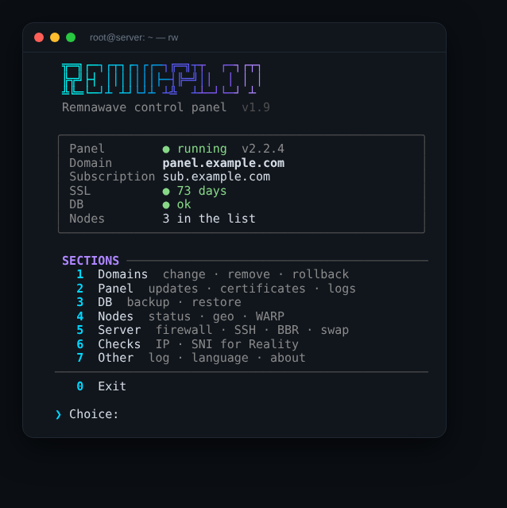
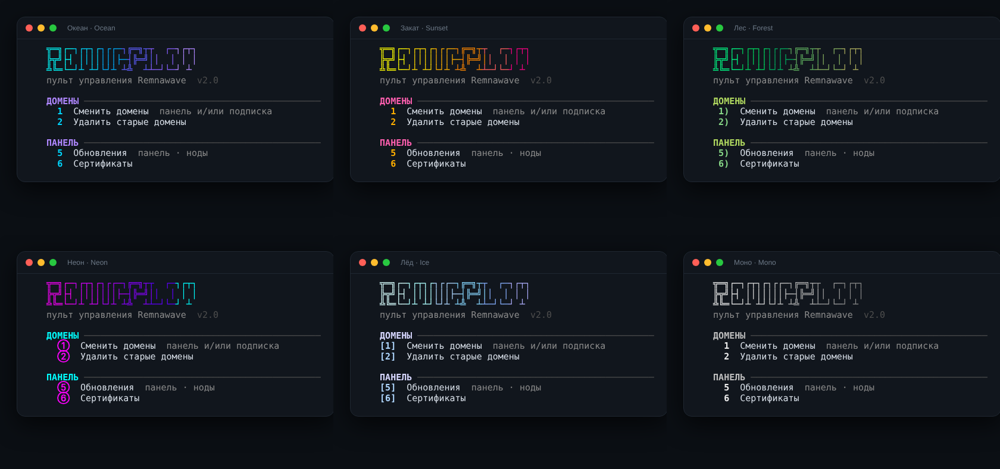

<div align="center">

# 🛰️ RemnaPilot

### A terminal control panel for [Remnawave](https://docs.rw)

Domains, certificates, updates, nodes, backups and server hardening —<br>
one `rw` command instead of a dozen guides.

[](https://github.com/Dubstep2004/RemnaPilot/releases/latest)
[](https://github.com/Dubstep2004/RemnaPilot/actions)
[](LICENSE)
[](#-requirements)

[Русский](README.md) · **English** · [Changelog (RU)](CHANGELOG.md) · [Releases](https://github.com/Dubstep2004/RemnaPilot/releases)



</div>

---

## ⚡ Install in 30 seconds

**1.** SSH into your panel (or node) server as `root`.

**2.** Paste one line:

```bash
bash <(curl -sSL https://raw.githubusercontent.com/Dubstep2004/RemnaPilot/main/remnapilot.sh) --lang en
```

**3.** Done. From now on open the menu with:

```bash
rw
```

> [!TIP]
> No GitHub access from the server? Download `remnapilot.sh` from the [latest release](https://github.com/Dubstep2004/RemnaPilot/releases/latest), copy it to the server and run `sudo bash remnapilot.sh --lang en`.

---

<!-- whats-new:start -->
## 🆕 What's new in v2.9

#### ✨ New

- Ready Xray profiles: Nodes → Ready Xray profiles. VLESS + Reality, VLESS + XHTTP, Trojan, Hysteria2 and "all in one" (Reality + XHTTP + Hysteria2) — keys, ports and sniffing are right from the start; RemnaPilot adds inbounds to squads, switches nodes and creates client hosts
- Hysteria2 on node: Nodes → Hysteria2 on node. Let's Encrypt certificate (certbot), NET_ADMIN, /dev/shm and the certificate in the node docker-compose, node restart after renewal, the UDP port in the firewall — what used to be done by hand

#### 🔄 Changed

- Menu: two new items in "Nodes", the numbers in "Server" and "Other" moved by 2

<details>
<summary><b>Previous version — v2.8</b></summary>

#### ✨ New

- Panel and node on one server: Install → Panel and node on one server. The node is installed next to the panel and added to it right away; the node port is not opened to the outside
- Subscription page: Install → Subscription page. remnawave/subscription-page on its own domain, with a certificate; clients' links stay the same
- Reinstall panel: fresh images and containers, the database recreated from a backup — users, nodes and settings are kept
- Close panel login: Protection → Close panel login. Only your IPs or a secret link, everyone else gets 404. Clients' subscriptions keep working
- Panel password brute-force protection: fail2ban bans an IP after 5 wrong passwords, nginx allows at most 10 attempts per minute
- Selfsteal for Reality: Nodes → Selfsteal. Your own site with a certificate on the node domain; RemnaPilot sets it in the Reality inbound itself
- Torrent blocking: an Xray rule in all profiles or the Torrent Blocker plugin (IP ban for an hour) with NET_ADMIN for nodes
- Ad and tracker blocking: Xray on the nodes blocks ad domains (geosite:category-ads-all)
- IPv6: Server → IPv6 — disable or enable here and on nodes over SSH, with protection against cutting an IPv6 SSH session
- Multi-panel: Panel → Multi-panel. Status of other panel servers, their menu over SSH, backup and update of all at once

#### 🚀 Improved

- New nodes are installed with the NET_ADMIN right — needed by node plugins (Torrent Blocker etc.)

#### 🔄 Changed

- The menu is split into new sections: Install, Domains, Panel, Protection, Nodes, Server, Other. Numbers in the full list changed — word search works as before

</details>

📜 [Full changelog (RU)](CHANGELOG.md) · 🏷️ [All releases](https://github.com/Dubstep2004/RemnaPilot/releases)

> After an update RemnaPilot shows what's new by itself. Full history in the terminal — `rw --changelog`.


<!-- whats-new:end -->

---

## ✨ Features

<table>
<tr>
<td width="50%" valign="top">

### 🌐 Domains
- Change the **panel and subscription** domains at once
- Keep the old subscription domain working — **clients don't break**
- **Change a node's domain** — in the panel and for clients at once
- Remove old domains and aliases
- Preview and **roll back** any change

</td>
<td width="50%" valign="top">

### 🔒 Certificates
- Port 80, 443, Cloudflare DNS or manual DNS
- Busy or closed port — a **clear reason** and another method
- Auto-renewal that doesn't break

</td>
</tr>
<tr>
<td valign="top">

### 🔄 Updates
- Panel, subscription page, nodes — with **backup and rollback**
- **Nightly update check** with a menu hint
- Optional fully automatic updates at night

</td>
<td valign="top">

### 💾 Backups
- Database backup and restore
- **Scheduled auto-backup**
- Archive delivered **to Telegram**, password-encrypted 🔒

</td>
</tr>
<tr>
<td valign="top">

### 🖥️ Panel and nodes
- **Install the panel** from scratch: Nginx or Caddy, certificate, secrets
- **Panel and node on one server** — the node appears in the panel right away
- **Subscription page** on its own domain
- **Reinstall the panel** keeping all data
- **Multi-panel** — other panel servers from one menu
- Install a node locally, via SSH or with one command — with a domain check
- **Forgot the password** — reset with guidance
- Delete the panel or a node — with a backup and confirmation
- **All nodes status** on one screen
- geoip / geosite, **WARP** for ChatGPT etc.

</td>
<td valign="top">

### 🛡️ Protection and server
- **Close panel login**: only your IPs or a secret link
- Panel **password brute-force protection** (fail2ban)
- One-click **firewall** and a clear **rules list**
- SSH hardening: port, fail2ban, key-only login
- IPv6 on/off, BBR, swap, time sync, disk cleanup
- **Move the panel** to another server

</td>
</tr>
<tr>
<td valign="top">

### 🚫 Nodes: protocols, disguise and blocking
- **Ready Xray profiles**: Reality, XHTTP, Trojan, Hysteria2 and "all in one"
- **Hysteria2 on node**: certificate, NET_ADMIN, UDP port — one button
- **Selfsteal for Reality** — your own site on the node domain
- **Torrent blocking** (Xray rule or Torrent Blocker)
- **Ad and tracker blocking** for all clients
- **Reality SNI** picker, IP check **from Russia**

</td>
<td valign="top">

### 🎨 Comfort
- 6 themes, number style, logo
- Word **search** and compact mode
- **Clear errors**: the cause and what to do
- Log by day with filters and search
- English and Russian

</td>
</tr>
</table>

---

## 🎨 Make it yours

Everything is in **Other → Appearance**: theme, number style (`1` `1)` `[1]` `1.` `①`), logo, status view, compact mode, a sectioned menu and **live status** — the status box refreshes by itself while the menu is open.

**Search** — instead of a number, type a word like `cert`, `backup` or `warp` and the item opens right away.

<div align="center">

</div>

---

## ⌨️ CLI

| Command | What it does |
|---|---|
| `rw` | open the menu |
| `rw --help` | every command with examples |
| `rw new.domain.com` | change the panel domain |
| `rw --sub sub.domain.com` | change the subscription domain |
| `rw --dry-run new.domain.com` | preview without changes |
| `rw --update` / `--update-all` | update the panel / panel and nodes |
| `rw --check-updates` | check what can be updated |
| `rw --backup` | back up and send to Telegram |
| `rw --cert-status` | certificate expiry |
| `rw --decrypt file.tar.gz.enc` | decrypt a backup archive from Telegram |
| `rw --selftest` | check the server is ready (read-only) |
| `rw --self-update` | update RemnaPilot itself (authenticity-checked) |
| `rw --verify` | check that the file matches the official release |
| `rw --uninstall` | remove RemnaPilot (panel and nodes are not touched) |
| `rw --lang en` | English interface |

---

## ❓ FAQ

<details>
<summary><b>Forgot the panel password?</b></summary>

**Panel → Forgot the panel password.** The old password can't be recovered — the panel stores only its hash — but the superadmin can be reset with the official Rescue CLI. Users, nodes and settings stay. Right after the reset open the panel and register a new administrator: whoever opens it first becomes the admin.
</details>

<details>
<summary><b>Is it safe?</b></summary>

Configs and the database are backed up before every change; domain changes and updates can be rolled back. Risky actions — SSH port, firewall, key-only login — are checked so you don't lose access. Everything is logged to `/var/log/remnapilot.log`.
</details>

<details>
<summary><b>How do I know my RemnaPilot is genuine?</b></summary>

Every [release](https://github.com/Dubstep2004/RemnaPilot/releases) ships a SHA-256 checksum. Each update is verified against it and **a file with a mismatching checksum is never installed**. Check the installed file with `rw --verify` or **Other → About**.
</details>

<details>
<summary><b>How do I uninstall it?</b></summary>

**Other → Remove RemnaPilot** or `rw --uninstall`. The panel, nodes, database, certificates, backups and server settings stay. Settings and the node list can be saved before removal.
</details>

<details>
<summary><b>How do I update RemnaPilot?</b></summary>

It checks for a new version every night and shows a hint in the menu. Update via **Panel → Updates → RemnaPilot** or `rw --self-update`. Fully automatic updates: **Panel → Updates → Auto-update**.
</details>

<details>
<summary><b>How do I get backups in Telegram?</b></summary>

**Panel → Auto-backup → Telegram** → create a bot with @BotFather, paste the token and send the bot any message — the script finds your chat automatically. Then set a password in **Encryption for Telegram**: the archive contains panel secrets, so it is not sent without one. Restore: `rw --decrypt archive.tar.gz.enc`. Keep the password in a password manager.
</details>

---

## 📋 Requirements

- Debian or Ubuntu (most features work on other systemd distributions)
- Remnawave installed per the [official guide](https://docs.rw)
- `root` access

## 🧪 Tests

Two stages, both in GitHub Actions. **No release is published if any check fails.**

- **On stubs** — every change: domains, certificates, updates and rollback, nodes, backups, firewall, the whole menu in both languages and English translation completeness.
- **On a real Remnawave** — the panel is installed per [docs.rw](https://docs.rw) on a clean machine, and RemnaPilot really changes the domain and rolls it back, backs up and restores the database, updates the panel, and explains real Docker errors on a deliberately broken panel. Also weekly, to catch a new Remnawave version breaking something.

## 📄 License

© 2026 Dubstep2004. **All rights reserved.** See [LICENSE](LICENSE).

You may use RemnaPilot on your servers (including commercially), read the code and send Issues and Pull Requests. Publishing copies (modified or not), selling it or presenting it as your own requires the author's written permission.
