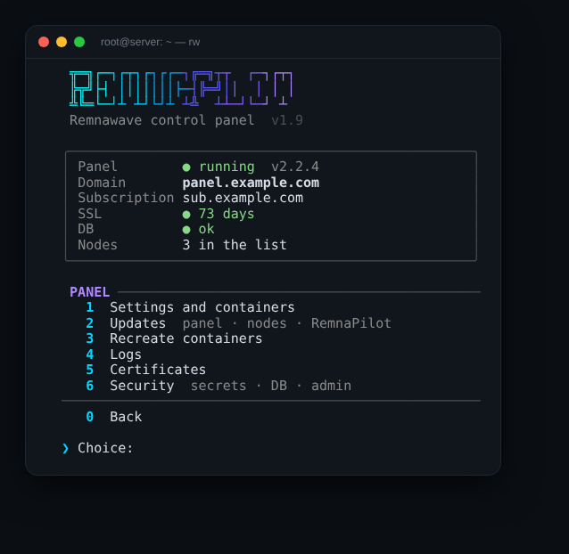

# RemnaPilot

**A terminal control panel for [Remnawave](https://docs.rw):** domains, certificates, updates, nodes, backups and server hardening — with a single `rw` command.

[Русский](README.md) · [Changelog (RU)](CHANGELOG.md)

<p align="center">
  
  
</p>

## Install

On the panel (or node) server, as root:

```bash
bash <(curl -sSL https://raw.githubusercontent.com/Dubstep2004/RemnaPilot/main/remnapilot.sh) --lang en
```

The script offers to install the `rw` command — after that just run:

```bash
rw
```

Switch the language any time: **Other → Language** or `rw --lang en`.

## Menu

The main screen shows the panel status and 7 sections: **Domains, Panel, Database, Nodes, Server, Checks, Other**. Items open inside a section — handy even on a phone. Prefer everything at once? **Other → Menu view → full list**.

## Features

**Domains**
- Change the panel and subscription domains at once: one backup, one restart, certificates for both
- Keep the old subscription domain working so clients don't break
- Remove old domains and aliases from Nginx, Caddy and Traefik
- Preview and roll back any change

**Certificates**
- Issue via port 80, 443 (TLS-ALPN), Cloudflare DNS or manual DNS
- If a port is busy or closed — a clear reason and another method to choose
- Auto-renewal that survives a busy port

**Panel & database**
- Update the panel, subscription page and nodes with a DB backup and rollback
- Pin the panel version
- Database backup and restore, secrets and DB password check
- Container logs with error filtering

**Nodes**
- Install a node locally, via SSH or with a copy-paste command
- All nodes status on one screen: version, CPU, RAM, disk, uptime
- Bulk update via SSH
- geoip / geosite (Loyalsoldier or runetfreedom), WARP for ChatGPT and other sites

**Server**
- One-click firewall (ufw) that respects Xray and node ports
- SSH hardening: port change with a check, fail2ban, key-only login
- BBR and network tuning, swap, time sync, disk cleanup
- Move the panel to another server in one scenario

**Checks**
- Is the server IP reachable from Russia, ping and speed
- Reality SNI picker: TLS 1.3, H2, X25519 and neighbor search in the subnet

## CLI

```bash
rw new.domain.com            # change the panel domain
rw --sub sub.domain.com      # change the subscription domain
rw --dry-run new.domain.com  # preview
rw --update                  # update the panel
rw --update-all              # panel + nodes
rw --cert-status             # certificate status
rw --self-update             # update RemnaPilot
rw --help
```

## Tests

Every push is checked in GitHub Actions on stubs (no network or Docker): domains, certificates, updates and rollback, nodes, geo, firewall, translation and the whole menu in both languages. No release is published if a test fails.

```bash
sudo bash tests/run.sh
```

## Requirements

- Debian / Ubuntu (most features work on other systemd distributions)
- Remnawave installed per the official guide (default `/opt/remnawave`)
- root

## License

[MIT](LICENSE)
