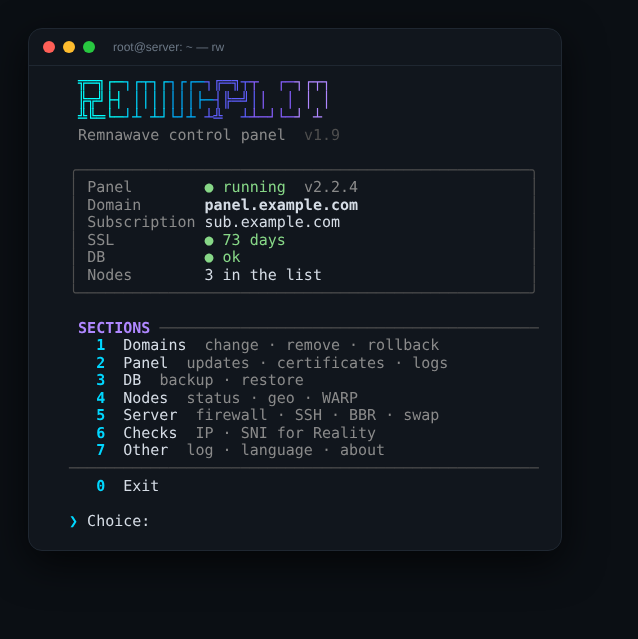
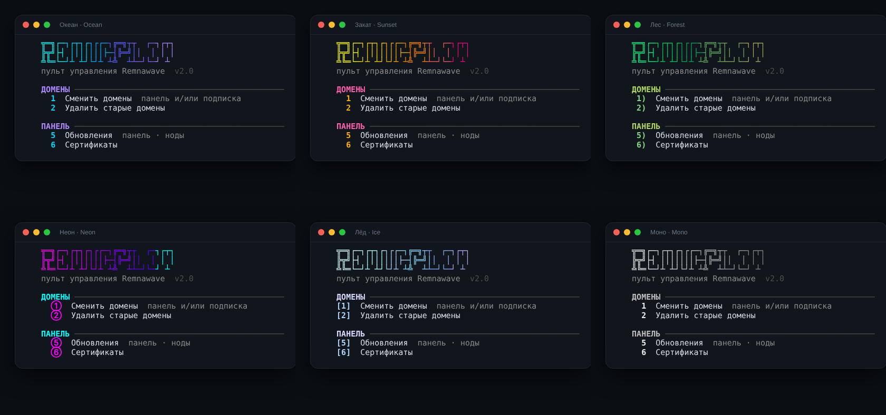

<div align="center">

# 🛰️ RemnaPilot

### A terminal control panel for [Remnawave](https://docs.rw)

Domains, certificates, updates, nodes, backups and server hardening —<br>
one `rw` command instead of a dozen guides.

[](https://github.com/Dubstep2004/RemnaPilot/releases/latest)
[](https://github.com/Dubstep2004/RemnaPilot/actions)
[](LICENSE)
[](#-requirements)

[Русский](README.md) · **English** · [Changelog (RU)](CHANGELOG.md) · [Releases](https://github.com/Dubstep2004/RemnaPilot/releases)



</div>

---

## ⚡ Install in 30 seconds

**1.** SSH into your panel (or node) server as `root`.

**2.** Paste one line:

```bash
bash <(curl -sSL https://raw.githubusercontent.com/Dubstep2004/RemnaPilot/main/remnapilot.sh) --lang en
```

**3.** Done. From now on open the menu with:

```bash
rw
```

> [!TIP]
> No GitHub access from the server? Download `remnapilot.sh` from the [latest release](https://github.com/Dubstep2004/RemnaPilot/releases/latest), copy it to the server and run `sudo bash remnapilot.sh --lang en`.

---

<!-- whats-new:start -->
## 🆕 What's new in v2.3

#### ✨ New

- Server self-test rw --selftest: Docker, Compose, cron, network, ports, DNS, clock, acme.sh — read-only

#### 🚀 Improved

- The menu opens twice as fast: one Docker call per screen instead of seven
- Sources split into modules in src/, remnapilot.sh is built from them; CI won't release a changed script without a new version

#### 🐛 Fixed

- Concurrency lock: auto-backup, auto-update and menu actions no longer change the server at the same time — the second waits for the first
- A clear error when Docker Compose v2 is missing (instead of "unknown command")
- The authenticity check no longer raises false alarms: for old releases the file itself is compared, calmer message
- Menu search is case-insensitive for Russian words even on servers without a UTF-8 locale

#### 🛡️ Security

- Telegram backups are encrypted with a password (AES-256); until a password is set, the archive with secrets is not sent. Decrypt — rw --decrypt
- The Telegram bot token is no longer visible in the process list (ps)

<details>
<summary><b>Previous version — v2.2.1</b></summary>

#### 🔄 Changed

- Removed favorites, hidden items and quick keys — the menu is a plain list again; word search and compact mode remain

</details>

📜 [Full changelog (RU)](CHANGELOG.md) · 🏷️ [All releases](https://github.com/Dubstep2004/RemnaPilot/releases)

> After an update RemnaPilot shows what's new by itself. Full history in the terminal — `rw --changelog`.


<!-- whats-new:end -->

---

## ✨ Features

<table>
<tr>
<td width="50%" valign="top">

### 🌐 Domains
- Change the **panel and subscription** domains at once
- Keep the old subscription domain working — **clients don't break**
- Remove old domains and aliases
- Preview and **roll back** any change

</td>
<td width="50%" valign="top">

### 🔒 Certificates
- Port 80, 443, Cloudflare DNS or manual DNS
- Busy or closed port — a **clear reason** and another method
- Auto-renewal that doesn't break

</td>
</tr>
<tr>
<td valign="top">

### 🔄 Updates
- Panel, subscription page, nodes — with **backup and rollback**
- **Nightly update check** with a menu hint
- Optional fully automatic updates at night

</td>
<td valign="top">

### 💾 Backups
- Database backup and restore
- **Scheduled auto-backup**
- Archive delivered **to Telegram**, password-encrypted 🔒

</td>
</tr>
<tr>
<td valign="top">

### 🖥️ Nodes
- Install locally, via SSH or with one command
- **All nodes status** on one screen
- geoip / geosite, **WARP** for ChatGPT etc.

</td>
<td valign="top">

### 🛡️ Server
- One-click **firewall**
- SSH hardening: port, fail2ban, key-only login
- BBR, swap, time sync, disk cleanup
- **Move the panel** to another server

</td>
</tr>
<tr>
<td valign="top">

### 🔎 Checks
- Is the IP reachable **from Russia**, ping, speed
- **Reality SNI** picker

</td>
<td valign="top">

### 🎨 Comfort
- 6 themes, number style, logo
- Word **search** and compact mode
- English and Russian, action log

</td>
</tr>
</table>

---

## 🎨 Make it yours

Everything is in **Other → Appearance**: theme, number style (`1` `1)` `[1]` `1.` `①`), logo, status view, compact mode and a sectioned menu.

**Search** — instead of a number, type a word like `cert`, `backup` or `warp` and the item opens right away.

<div align="center">

</div>

---

## ⌨️ CLI

| Command | What it does |
|---|---|
| `rw` | open the menu |
| `rw new.domain.com` | change the panel domain |
| `rw --sub sub.domain.com` | change the subscription domain |
| `rw --dry-run new.domain.com` | preview without changes |
| `rw --update` / `--update-all` | update the panel / panel and nodes |
| `rw --check-updates` | check what can be updated |
| `rw --backup` | back up and send to Telegram |
| `rw --cert-status` | certificate expiry |
| `rw --decrypt file.tar.gz.enc` | decrypt a backup archive from Telegram |
| `rw --selftest` | check the server is ready (read-only) |
| `rw --self-update` | update RemnaPilot itself (authenticity-checked) |
| `rw --verify` | check that the file matches the official release |
| `rw --uninstall` | remove RemnaPilot (panel and nodes are not touched) |
| `rw --lang en` | English interface |

---

## ❓ FAQ

<details>
<summary><b>Is it safe?</b></summary>

Configs and the database are backed up before every change; domain changes and updates can be rolled back. Risky actions — SSH port, firewall, key-only login — are checked so you don't lose access. Everything is logged to `/var/log/remnapilot.log`.
</details>

<details>
<summary><b>How do I know my RemnaPilot is genuine?</b></summary>

Every [release](https://github.com/Dubstep2004/RemnaPilot/releases) ships a SHA-256 checksum. Each update is verified against it and **a file with a mismatching checksum is never installed**. Check the installed file with `rw --verify` or **Other → About**.
</details>

<details>
<summary><b>How do I uninstall it?</b></summary>

**Other → Remove RemnaPilot** or `rw --uninstall`. The panel, nodes, database, certificates, backups and server settings stay. Settings and the node list can be saved before removal.
</details>

<details>
<summary><b>How do I update RemnaPilot?</b></summary>

It checks for a new version every night and shows a hint in the menu. Update via **Panel → Updates → RemnaPilot** or `rw --self-update`. Fully automatic updates: **Panel → Updates → Auto-update**.
</details>

<details>
<summary><b>How do I get backups in Telegram?</b></summary>

**Database → Auto-backup → Telegram** → create a bot with @BotFather, paste the token and send the bot any message — the script finds your chat automatically. Then set a password in **Encryption for Telegram**: the archive contains panel secrets, so it is not sent without one. Restore: `rw --decrypt archive.tar.gz.enc`. Keep the password in a password manager.
</details>

---

## 📋 Requirements

- Debian or Ubuntu (most features work on other systemd distributions)
- Remnawave installed per the [official guide](https://docs.rw)
- `root` access

## 🧪 Tests

Every change runs in GitHub Actions on stubs: domains, certificates, updates and rollback, nodes, backups, firewall, appearance and the whole menu in both languages. **No release is published if a test fails.**

## 📄 License

© 2026 Dubstep2004. **All rights reserved.** See [LICENSE](LICENSE).

You may use RemnaPilot on your servers (including commercially), read the code and send Issues and Pull Requests. Publishing copies (modified or not), selling it or presenting it as your own requires the author's written permission.
