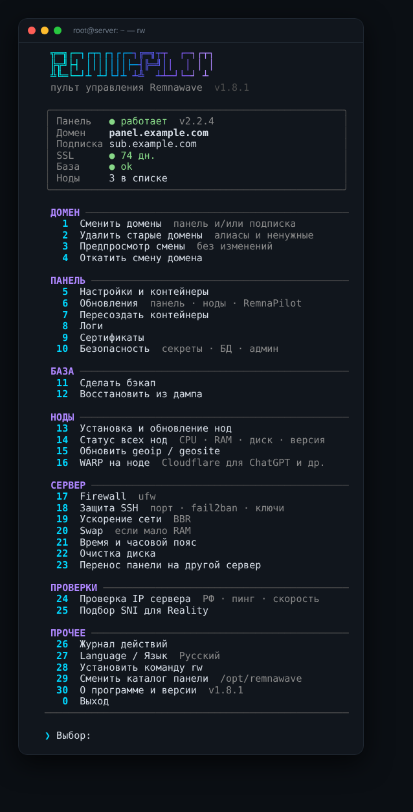
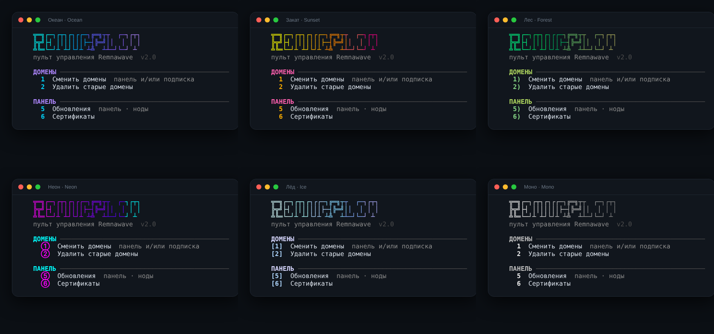

<div align="center">

# 🛰️ RemnaPilot

### Пульт управления [Remnawave](https://docs.rw) прямо в терминале

Домены, сертификаты, обновления, ноды, бэкапы и защита сервера —<br>
одна команда `rw` вместо десятка инструкций.

[](https://github.com/Dubstep2004/RemnaPilot/releases/latest)
[](https://github.com/Dubstep2004/RemnaPilot/actions)
[](LICENSE)
[](#-требования)

**Русский** · [English](README.en.md) · [Что нового](CHANGELOG.md) · [Релизы](https://github.com/Dubstep2004/RemnaPilot/releases)



</div>

---

## ⚡ Установка за 30 секунд

**1.** Зайди на сервер с панелью (или с нодой) по SSH под `root`.

**2.** Вставь одну строку:

```bash
bash <(curl -sSL https://raw.githubusercontent.com/Dubstep2004/RemnaPilot/main/remnapilot.sh)
```

**3.** Готово. Дальше открывай меню командой:

```bash
rw
```

> [!TIP]
> Нет доступа к GitHub с сервера? Скачай `remnapilot.sh` из [последнего релиза](https://github.com/Dubstep2004/RemnaPilot/releases/latest), закинь на сервер и запусти `sudo bash remnapilot.sh`.

---

<!-- whats-new:start -->
## 🆕 Что нового в v2.8


#### ✨ Новое

- Панель и нода на одном сервере: Установка → Панель и нода на одном сервере. Нода ставится рядом с панелью и сразу добавляется в неё, порт ноды наружу не открывается
- Страница подписки: Установка → Страница подписки. remnawave/subscription-page на своём домене, с сертификатом; ссылки клиентов прежние
- Переустановить панель: свежие образы и контейнеры, база заново из бэкапа — пользователи, ноды и настройки сохраняются
- Закрыть вход в панель: Защита → Закрыть вход в панель. Только свои IP или секретная ссылка, остальным — 404. Подписка клиентов работает
- Защита от перебора пароля панели: fail2ban банит IP после 5 неверных паролей, nginx пускает не больше 10 попыток в минуту
- Selfsteal для Reality: Ноды → Selfsteal. Свой сайт с сертификатом на домене ноды, RemnaPilot сам пропишет его в inbound Reality
- Блокировка торрентов: правило Xray во всех профилях или плагин Torrent Blocker (бан IP на час) с NET_ADMIN для нод
- Блокировка рекламы и трекеров: Xray на нодах не пускает к рекламным доменам (geosite:category-ads-all)
- IPv6: Сервер → IPv6 — выключить или включить здесь и на нодах по SSH, с защитой от обрыва SSH по IPv6
- Мультипанель: Панель → Мультипанель. Статус других серверов с панелью, их меню по SSH, бэкап и обновление всех сразу

#### 🚀 Улучшено

- Новые ноды ставятся с правом NET_ADMIN — нужно плагинам нод (Torrent Blocker и др.)

#### 🔄 Изменено

- Меню разложено по новым разделам: Установка, Домены, Панель, Защита, Ноды, Сервер, Прочее. Номера в полном списке поменялись — поиск по слову работает как раньше

<details>
<summary><b>Предыдущая версия — v2.7</b></summary>

#### ✨ Новое

- Удалить панель: Прочее → Удалить панель. Контейнеры, база, сертификаты и каталог панели — с последним бэкапом вне панели и подтверждением словом УДАЛИТЬ
- Удалить ноду: Ноды → Установка и обновление нод → Удалить ноду. На этом сервере или по SSH, с подтверждением словом УДАЛИТЬ
- Обновить RemnaPilot — пункт прямо в главном меню (раздел «Прочее»), рядом видно, вышла ли новая версия

#### 🔄 Изменено

- «Удалить ноду из списка» переименован в «Убрать ноду из списка» — чтобы не путать с удалением самой ноды

</details>

📜 [Вся история изменений](CHANGELOG.md) · 🏷️ [Все релизы](https://github.com/Dubstep2004/RemnaPilot/releases)

> После обновления RemnaPilot сам покажет, что нового. Вся история в терминале — `rw --changelog`.

<br clear="right">
<!-- whats-new:end -->

---

## ✨ Что умеет

<table>
<tr>
<td width="50%" valign="top">

### 🌐 Домены
- Смена домена **панели и подписки** за один раз
- Старый домен подписки остаётся рабочим — **у клиентов ничего не отвалится**
- **Смена домена ноды** — в панели и у клиентов сразу
- Удаление старых доменов и алиасов
- Предпросмотр и **откат** любого изменения

</td>
<td width="50%" valign="top">

### 🔒 Сертификаты
- Порт 80, 443, DNS Cloudflare или DNS вручную
- Порт занят или закрыт — скрипт **объяснит причину** и предложит другой способ
- Автопродление, которое не ломается

</td>
</tr>
<tr>
<td valign="top">

### 🔄 Обновления
- Панель, страница подписки, ноды — с **бэкапом и откатом**
- **Автопроверка каждую ночь** и подсказка в меню
- По желанию — обновление само, ночью

</td>
<td valign="top">

### 💾 Бэкапы
- Бэкап и восстановление базы
- **Автобэкап по расписанию**
- Архив приходит **в Telegram**, зашифрованный паролем 🔒

</td>
</tr>
<tr>
<td valign="top">

### 🖥️ Панель и ноды
- **Установка панели** с нуля: Nginx или Caddy, сертификат, секреты
- **Панель и нода на одном сервере** — нода сразу появляется в панели
- **Страница подписки** на своём домене
- **Переустановка панели** с сохранением всех данных
- **Мультипанель** — другие серверы с панелью из одного меню
- Установка ноды: здесь, по SSH или одной командой — с проверкой домена
- **Забыл пароль** от панели — сброс с подсказками
- Удаление панели и ноды — с бэкапом и подтверждением
- **Статус всех нод** на одном экране
- geoip / geosite, **WARP** для ChatGPT и др.

</td>
<td valign="top">

### 🛡️ Защита и сервер
- **Закрыть вход в панель**: только свои IP или секретная ссылка
- **Защита от перебора пароля** панели (fail2ban)
- **Firewall** одной кнопкой и понятный **список правил**
- Защита SSH: порт, fail2ban, вход по ключу
- IPv6 вкл/выкл, BBR, swap, время, очистка диска
- **Перенос панели** на другой сервер

</td>
</tr>
<tr>
<td valign="top">

### 🚫 Ноды: маскировка и блокировки
- **Selfsteal для Reality** — свой сайт на домене ноды
- **Блокировка торрентов** (правило Xray или Torrent Blocker)
- **Блокировка рекламы и трекеров** для всех клиентов
- Подбор **SNI для Reality**, проверка IP **из России**

</td>
<td valign="top">

### 🎨 Удобство
- 6 тем, стиль номеров, логотип
- **Поиск** по слову и компактный режим
- **Понятные ошибки**: причина и что делать
- Журнал по дням с фильтрами и поиском
- Русский и English

</td>
</tr>
</table>

---

## 🎨 Меню и оформление на твой вкус

Всё настраивается в **Прочее → Оформление**:

| Настройка | Варианты |
|---|---|
| Тема | Океан · Закат · Лес · Неон · Лёд · Моно |
| Номера пунктов | `1` · `1)` · `[1]` · `1.` · `①` |
| Логотип | большой · маленький · без логотипа |
| Статус сервера | рамка · одна строка · скрыт |
| Компактный режим | без пустых строк — всё меню на один экран телефона |
| Живой статус | рамка статуса сама обновляется, пока меню открыто: каждые 3, 5, 10 или 30 секунд |
| Вид меню | полный список · разделы |

**Поиск** — вместо номера введи слово, например `серт`, `бэкап` или `warp`, и нужный пункт откроется сразу.

<div align="center">

</div>

---

## 🧭 Карта меню


| Раздел | Пункты |
|---|---|
| 📦 **Установка** | `1` Установить панель · `2` Панель и нода на одном сервере · `3` Установка и обновление нод · `4` Страница подписки · `5` Переустановить панель |
| 🌐 **Домены** | `6` Сменить домены · `7` Сменить домен ноды · `8` Удалить старые · `9` Предпросмотр · `10` Откат |
| ⚙️ **Панель** | `11` Настройки · `12` Обновления · `13` Пересоздать контейнеры · `14` Логи · `15` Сертификаты · `16` Бэкап · `17` Автобэкап · `18` Восстановление · `19` Перенос панели · `20` Мультипанель |
| 🔐 **Защита** | `21` Закрыть вход в панель · `22` Защита от перебора пароля · `23` Забыл пароль · `24` Безопасность · `25` Firewall · `26` Защита SSH |
| 🖥️ **Ноды** | `27` Статус всех нод · `28` Selfsteal · `29` Блокировка торрентов · `30` Блокировка рекламы · `31` geoip/geosite · `32` WARP · `33` Подбор SNI · `34` Проверка IP |
| 🛡️ **Сервер** | `35` IPv6 · `36` Ускорение сети · `37` Swap · `38` Время · `39` Очистка |
| 🎨 **Прочее** | `40` Оформление · `41` Telegram · `42` Журнал · `43` Язык · `44` Команда rw · `45` Каталог панели · `46` О программе · `47` Обновить RemnaPilot · `48` Удалить панель · `49` Удалить RemnaPilot |

---

## ⌨️ Команды без меню

| Команда | Что делает |
|---|---|
| `rw` | открыть меню |
| `rw --help` | все команды с примерами |
| `rw new.domain.com` | сменить домен панели |
| `rw --sub sub.domain.com` | сменить домен подписки |
| `rw --dry-run new.domain.com` | показать, что изменится, ничего не меняя |
| `rw --update` / `--update-all` | обновить панель / панель и ноды |
| `rw --check-updates` | проверить, что можно обновить |
| `rw --backup` | сделать бэкап и отправить в Telegram |
| `rw --decrypt файл.tar.gz.enc` | расшифровать архив бэкапа из Telegram |
| `rw --selftest` | проверить, всё ли готово на сервере (ничего не меняет) |
| `rw --cert-status` | срок действия сертификатов |
| `rw --self-update` | обновить сам RemnaPilot (с проверкой подлинности) |
| `rw --verify` | проверить, что файл совпадает с официальным релизом |
| `rw --uninstall` | удалить RemnaPilot (панель и ноды не трогаются) |
| `rw --lang en` | английский интерфейс |

---

## ❓ Частые вопросы

<details>
<summary><b>Забыл пароль от панели — что делать?</b></summary>

**Панель → Забыл пароль от панели.** Узнать старый пароль нельзя — панель хранит только его хеш, — но можно сбросить суперадмина через официальный Rescue CLI. Пользователи, ноды и настройки остаются. Сразу после сброса открой панель и зарегистрируй нового администратора: им станет тот, кто откроет панель первым.
</details>

<details>
<summary><b>Это безопасно? Скрипт ничего не сломает?</b></summary>

Перед любым изменением делается бэкап конфигов и базы, у смены домена и обновления есть откат. Опасные действия — смена порта SSH, firewall, вход только по ключу — проверяются так, чтобы ты не потерял доступ к серверу. Всё записывается в журнал: `/var/log/remnapilot.log`.
</details>

<details>
<summary><b>Как понять, что у меня настоящий RemnaPilot, а не подделка?</b></summary>

К каждому [релизу](https://github.com/Dubstep2004/RemnaPilot/releases) прикладывается контрольная сумма SHA-256. Скрипт сверяет с ней каждое обновление и **не ставит файл, если сумма не совпала** — ни вручную, ни автоматически. Проверить уже установленный файл: `rw --verify` или **Прочее → О программе** — строка «Подлинность».

Ставь RemnaPilot только из этого репозитория.
</details>

<details>
<summary><b>Как удалить RemnaPilot?</b></summary>

**Прочее → Удалить RemnaPilot** или `rw --uninstall`. Удаляются команда `rw`, настройки скрипта и его задачи по расписанию. Панель, ноды, база, сертификаты, бэкапы и настройки сервера остаются. Перед удалением скрипт предложит сохранить список нод и настройки — чтобы вернуть всё после переустановки.
</details>

<details>
<summary><b>Как обновлять сам RemnaPilot?</b></summary>

Каждую ночь скрипт сам проверяет новую версию и показывает подсказку в меню. Обновить: **Панель → Обновления → RemnaPilot** или `rw --self-update`. Можно включить обновление полностью само: **Панель → Обновления → Автообновление**.
</details>

<details>
<summary><b>Как получать бэкапы в Telegram?</b></summary>

**Панель → Автобэкап → Telegram** → создай бота у @BotFather, вставь токен и напиши боту любое сообщение — скрипт сам найдёт твой чат. Затем **Шифрование для Telegram** — задай пароль: в архиве секреты панели, поэтому без пароля он в Telegram не уходит.

Восстановить: скачай архив из чата и выполни `rw --decrypt архив.tar.gz.enc` → `tar -xzf архив.tar.gz`. **Пароль храни в менеджере паролей** — без него архив не открыть.
</details>

<details>
<summary><b>Что-то не работает — с чего начать?</b></summary>

Запусти `rw --selftest`: он ничего не меняет, только проверяет Docker, Compose, cron, связь с GitHub, Telegram и Let's Encrypt, порты, DNS домена и точность часов — и покажет, что исправить. Вывод можно приложить к [Issue](https://github.com/Dubstep2004/RemnaPilot/issues).
</details>

<details>
<summary><b>Я сменил домен подписки — клиенты отвалятся?</b></summary>

Нет, если при смене ответить «да» на «Оставить старый домен рабочим?». Старые ссылки продолжат работать, а новые пользователи получат новый домен. Когда все перейдут — старый домен можно удалить: **Домены → Удалить старые домены**.
</details>

<details>
<summary><b>Панель стоит не в /opt/remnawave</b></summary>

**Прочее → Сменить каталог панели** — укажи папку, где лежит `.env` панели. Или запусти `rw --dir /путь/к/панели`.
</details>

---

## 📋 Требования

- Debian или Ubuntu (большинство функций работают и на других дистрибутивах с systemd)
- Remnawave, установленная по [официальной инструкции](https://docs.rw)
- Доступ `root`

## 🛠️ Для разработчиков

`remnapilot.sh` собирается из модулей в `src/` и словаря `src/i18n/en.tsv`:

```bash
python3 tools/build.py        # собрать remnapilot.sh из src/
python3 tools/changelog.py --write   # обновить CHANGELOG.md и «Что нового» в README
python3 tools/i18n_check.py   # все ли строки переведены на английский
sudo bash tests/run.sh        # тесты (на чистой машине)
```

Изменения истории — в `RP_CHANGELOG` в `src/17-version-changelog.sh`, формат `"версия|категория|текст"`. CI не пропустит загрузку, если скрипт не пересобран, история устарела или скрипт изменён без новой версии.

## 🧪 Тесты

Две ступени, обе в GitHub Actions. **Релиз не выходит, если хоть одна проверка упала.**

- **На заглушках** — каждое изменение: домены, сертификаты, обновления и откат, ноды, бэкапы, firewall, всё меню на двух языках и полнота английского перевода.
- **На настоящей Remnawave** — панель ставится по [docs.rw](https://docs.rw) в чистой машине, и RemnaPilot по-настоящему меняет домен и откатывает его, делает бэкап и восстанавливает базу, обновляет панель, а на намеренно сломанной панели объясняет настоящие ошибки Docker. Ещё раз в неделю — чтобы сразу заметить, если новая версия Remnawave что-то сломала.

```bash
sudo bash tests/run.sh   # на заглушках — на чистой машине, не на рабочем сервере
```

## 📄 Лицензия

© 2026 Dubstep2004. **Все права защищены.** [Полные условия](LICENSE).

| ✅ Можно | ❌ Нельзя без разрешения автора |
|---|---|
| Пользоваться на своих серверах, в том числе для бизнеса | Выкладывать копии, в том числе изменённые |
| Изучать код | Продавать или включать в платные продукты и сборки |
| Присылать исправления через Issues и Pull Requests | Выдавать за свою разработку, убирать имя автора |
| Делиться ссылкой на этот репозиторий | |

Нужно разрешение — создай [Issue](https://github.com/Dubstep2004/RemnaPilot/issues).

<div align="center">
<sub>Сделано для тех, кто держит свой VPN на Remnawave ❤️</sub>
</div>
