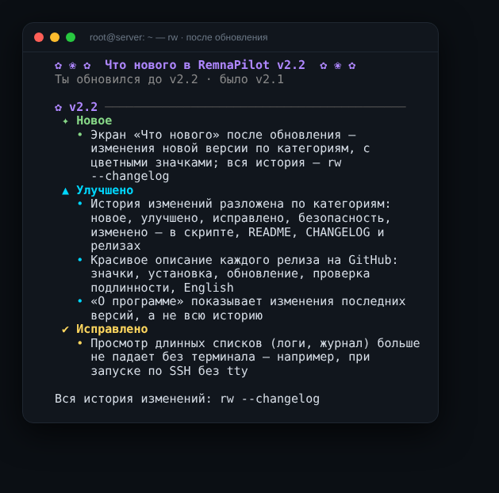
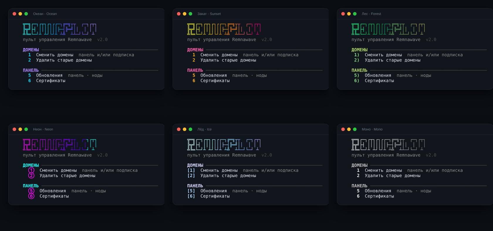

<div align="center">

# 🛰️ RemnaPilot

### Пульт управления [Remnawave](https://docs.rw) прямо в терминале

Домены, сертификаты, обновления, ноды, бэкапы и защита сервера —<br>
одна команда `rw` вместо десятка инструкций.

[](https://github.com/Dubstep2004/RemnaPilot/releases/latest)
[](https://github.com/Dubstep2004/RemnaPilot/actions)
[](LICENSE)
[](#-требования)

**Русский** · [English](README.en.md) · [Что нового](CHANGELOG.md) · [Релизы](https://github.com/Dubstep2004/RemnaPilot/releases)


</div>

---

## ⚡ Установка за 30 секунд

**1.** Зайди на сервер с панелью (или с нодой) по SSH под `root`.

**2.** Вставь одну строку:

```bash
bash <(curl -sSL https://raw.githubusercontent.com/Dubstep2004/RemnaPilot/main/remnapilot.sh)
```

**3.** Готово. Дальше открывай меню командой:

```bash
rw
```

> [!TIP]
> Нет доступа к GitHub с сервера? Скачай `remnapilot.sh` из [последнего релиза](https://github.com/Dubstep2004/RemnaPilot/releases/latest), закинь на сервер и запусти `sudo bash remnapilot.sh`.

---

<!-- whats-new:start -->
## 🆕 Что нового в v2.2



#### ✨ Новое

- Экран «Что нового» после обновления — изменения новой версии по категориям, с цветными значками; вся история — rw --changelog

#### 🚀 Улучшено

- История изменений разложена по категориям: новое, улучшено, исправлено, безопасность, изменено — в скрипте, README, CHANGELOG и релизах
- Красивое описание каждого релиза на GitHub: значки, установка, обновление, проверка подлинности, English
- «О программе» показывает изменения последних версий, а не всю историю

#### 🐛 Исправлено

- Просмотр длинных списков (логи, журнал) больше не падает без терминала — например, при запуске по SSH без tty

<details>
<summary><b>Предыдущая версия — v2.1</b></summary>

#### ✨ Новое

- Удаление RemnaPilot: Прочее → Удалить RemnaPilot или rw --uninstall; панель, ноды и бэкапы остаются
- Меню: избранное наверху, скрытие ненужных пунктов, быстрые клавиши (d, u, c…) и поиск по слову, компактный режим

#### 🛡️ Безопасность

- Защита обновлений: каждый релиз с контрольной суммой SHA-256; подменённый файл не установится ни вручную, ни автоматически
- Проверка подлинности: «О программе» и rw --verify показывают, совпадает ли файл с официальным релизом

#### 🔄 Изменено

- Лицензия: «Все права защищены» — пользоваться можно, распространять и продавать копии — только с разрешения автора

</details>

📜 [Вся история изменений](CHANGELOG.md) · 🏷️ [Все релизы](https://github.com/Dubstep2004/RemnaPilot/releases)

> После обновления RemnaPilot сам покажет, что нового. Вся история в терминале — `rw --changelog`.

<br clear="right">
<!-- whats-new:end -->

---

## ✨ Что умеет

<table>
<tr>
<td width="50%" valign="top">

### 🌐 Домены
- Смена домена **панели и подписки** за один раз
- Старый домен подписки остаётся рабочим — **у клиентов ничего не отвалится**
- Удаление старых доменов и алиасов
- Предпросмотр и **откат** любого изменения

</td>
<td width="50%" valign="top">

### 🔒 Сертификаты
- Порт 80, 443, DNS Cloudflare или DNS вручную
- Порт занят или закрыт — скрипт **объяснит причину** и предложит другой способ
- Автопродление, которое не ломается

</td>
</tr>
<tr>
<td valign="top">

### 🔄 Обновления
- Панель, страница подписки, ноды — с **бэкапом и откатом**
- **Автопроверка каждую ночь** и подсказка в меню
- По желанию — обновление само, ночью

</td>
<td valign="top">

### 💾 Бэкапы
- Бэкап и восстановление базы
- **Автобэкап по расписанию**
- Архив приходит **в Telegram**

</td>
</tr>
<tr>
<td valign="top">

### 🖥️ Ноды
- Установка: здесь, по SSH или одной командой
- **Статус всех нод** на одном экране
- geoip / geosite, **WARP** для ChatGPT и др.

</td>
<td valign="top">

### 🛡️ Сервер
- **Firewall** одной кнопкой
- Защита SSH: порт, fail2ban, вход по ключу
- BBR, swap, время, очистка диска
- **Перенос панели** на другой сервер

</td>
</tr>
<tr>
<td valign="top">

### 🔎 Проверки
- Доступен ли IP **из России**, пинг, скорость
- Подбор **SNI для Reality**

</td>
<td valign="top">

### 🎨 Удобство
- 6 тем, стиль номеров, логотип
- **Избранное**, скрытие пунктов, **быстрые клавиши** и поиск
- Русский и English, журнал всех действий

</td>
</tr>
</table>

---

## 🎨 Меню и оформление на твой вкус

Всё настраивается в **Прочее → Оформление**:

| Настройка | Варианты |
|---|---|
| Тема | Океан · Закат · Лес · Неон · Лёд · Моно |
| Номера пунктов | `1` · `1)` · `[1]` · `1.` · `①` |
| Логотип | большой · маленький · без логотипа |
| Статус сервера | рамка · одна строка · скрыт |
| ⭐ Избранное | до 9 своих пунктов наверху под номерами 1, 2, 3… |
| 🙈 Скрытые пункты | убрать то, чем не пользуешься, — номера пересчитаются |
| Компактный режим | без пустых строк — всё меню на один экран телефона |
| Вид меню | полный список · разделы |

**Быстрые клавиши** — вместо номера можно ввести букву (работает и в русской раскладке):

`d` домены · `u` обновления · `c` сертификаты · `l` логи · `b` бэкап · `n` ноды · `f` firewall · `s` SSH · `i` проверка IP · `o` оформление · `j` журнал

**Поиск** — введи слово, например `серт`, `бэкап` или `warp`, и нужный пункт откроется сразу. Находит и скрытые пункты.

<div align="center">

</div>

---

## 🧭 Карта меню

Номера по умолчанию — с избранным и скрытыми пунктами они пересчитываются.

| Раздел | Пункты |
|---|---|
| 🌐 **Домены** | `1` Сменить домены · `2` Удалить старые · `3` Предпросмотр · `4` Откат |
| ⚙️ **Панель** | `5` Настройки · `6` Обновления · `7` Пересоздать контейнеры · `8` Логи · `9` Сертификаты · `10` Безопасность |
| 💾 **База** | `11` Бэкап · `12` Автобэкап · `13` Восстановление |
| 🖥️ **Ноды** | `14` Установка и обновление · `15` Статус всех нод · `16` geoip/geosite · `17` WARP |
| 🛡️ **Сервер** | `18` Firewall · `19` Защита SSH · `20` Ускорение сети · `21` Swap · `22` Время · `23` Очистка · `24` Перенос панели |
| 🔎 **Проверки** | `25` Проверка IP · `26` Подбор SNI |
| 🎨 **Прочее** | `27` Оформление · `28` Telegram · `29` Журнал · `30` Язык · `31` Команда rw · `32` Каталог панели · `33` О программе · `34` Удалить RemnaPilot |

---

## ⌨️ Команды без меню

| Команда | Что делает |
|---|---|
| `rw` | открыть меню |
| `rw new.domain.com` | сменить домен панели |
| `rw --sub sub.domain.com` | сменить домен подписки |
| `rw --dry-run new.domain.com` | показать, что изменится, ничего не меняя |
| `rw --update` / `--update-all` | обновить панель / панель и ноды |
| `rw --check-updates` | проверить, что можно обновить |
| `rw --backup` | сделать бэкап и отправить в Telegram |
| `rw --cert-status` | срок действия сертификатов |
| `rw --self-update` | обновить сам RemnaPilot (с проверкой подлинности) |
| `rw --verify` | проверить, что файл совпадает с официальным релизом |
| `rw --uninstall` | удалить RemnaPilot (панель и ноды не трогаются) |
| `rw --lang en` | английский интерфейс |

---

## ❓ Частые вопросы

<details>
<summary><b>Это безопасно? Скрипт ничего не сломает?</b></summary>

Перед любым изменением делается бэкап конфигов и базы, у смены домена и обновления есть откат. Опасные действия — смена порта SSH, firewall, вход только по ключу — проверяются так, чтобы ты не потерял доступ к серверу. Всё записывается в журнал: `/var/log/remnapilot.log`.
</details>

<details>
<summary><b>Как понять, что у меня настоящий RemnaPilot, а не подделка?</b></summary>

К каждому [релизу](https://github.com/Dubstep2004/RemnaPilot/releases) прикладывается контрольная сумма SHA-256. Скрипт сверяет с ней каждое обновление и **не ставит файл, если сумма не совпала** — ни вручную, ни автоматически. Проверить уже установленный файл: `rw --verify` или **Прочее → О программе** — строка «Подлинность».

Ставь RemnaPilot только из этого репозитория.
</details>

<details>
<summary><b>Как удалить RemnaPilot?</b></summary>

**Прочее → Удалить RemnaPilot** или `rw --uninstall`. Удаляются команда `rw`, настройки скрипта и его задачи по расписанию. Панель, ноды, база, сертификаты, бэкапы и настройки сервера остаются. Перед удалением скрипт предложит сохранить список нод и настройки — чтобы вернуть всё после переустановки.
</details>

<details>
<summary><b>Как обновлять сам RemnaPilot?</b></summary>

Каждую ночь скрипт сам проверяет новую версию и показывает подсказку в меню. Обновить: **Панель → Обновления → RemnaPilot** или `rw --self-update`. Можно включить обновление полностью само: **Панель → Обновления → Автообновление**.
</details>

<details>
<summary><b>Как получать бэкапы в Telegram?</b></summary>

**База → Автобэкап → Telegram** → создай бота у @BotFather, вставь токен и напиши боту любое сообщение — скрипт сам найдёт твой чат. Дальше архив с базой будет приходить по расписанию.
</details>

<details>
<summary><b>Я сменил домен подписки — клиенты отвалятся?</b></summary>

Нет, если при смене ответить «да» на «Оставить старый домен рабочим?». Старые ссылки продолжат работать, а новые пользователи получат новый домен. Когда все перейдут — старый домен можно удалить: **Домены → Удалить старые домены**.
</details>

<details>
<summary><b>Панель стоит не в /opt/remnawave</b></summary>

**Прочее → Сменить каталог панели** — укажи папку, где лежит `.env` панели. Или запусти `rw --dir /путь/к/панели`.
</details>

---

## 📋 Требования

- Debian или Ubuntu (большинство функций работают и на других дистрибутивах с systemd)
- Remnawave, установленная по [официальной инструкции](https://docs.rw)
- Доступ `root`

## 🧪 Тесты

Каждое изменение проверяется в GitHub Actions: домены, сертификаты, обновления и откат, ноды, бэкапы, firewall, оформление и всё меню на двух языках. **Релиз не выходит, если хоть один тест упал.**

```bash
sudo bash tests/run.sh   # на чистой машине, не на рабочем сервере
```

## 📄 Лицензия

© 2026 Dubstep2004. **Все права защищены.** [Полные условия](LICENSE).

| ✅ Можно | ❌ Нельзя без разрешения автора |
|---|---|
| Пользоваться на своих серверах, в том числе для бизнеса | Выкладывать копии, в том числе изменённые |
| Изучать код | Продавать или включать в платные продукты и сборки |
| Присылать исправления через Issues и Pull Requests | Выдавать за свою разработку, убирать имя автора |
| Делиться ссылкой на этот репозиторий | |

Нужно разрешение — создай [Issue](https://github.com/Dubstep2004/RemnaPilot/issues).

<div align="center">
<sub>Сделано для тех, кто держит свой VPN на Remnawave ❤️</sub>
</div>
