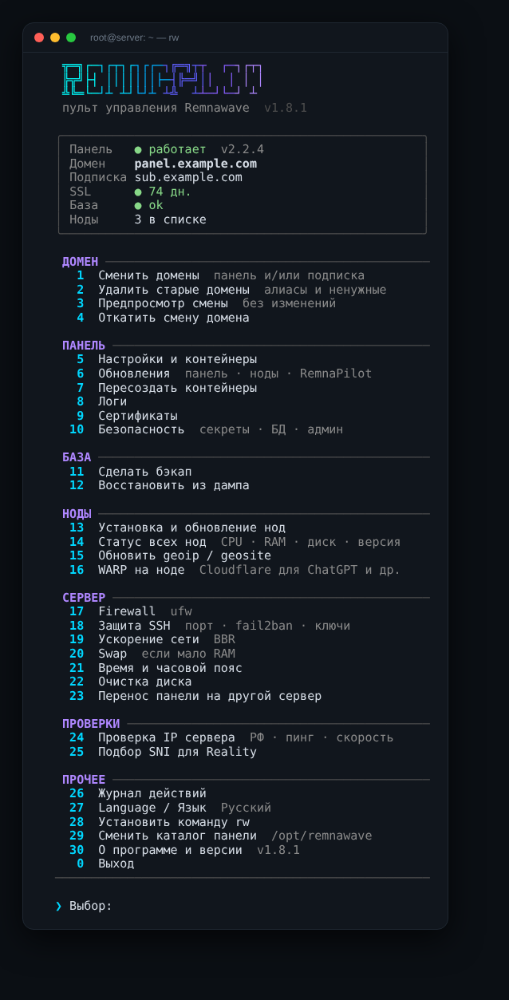

# RemnaPilot

**Пульт управления [Remnawave](https://docs.rw) в терминале:** домены, сертификаты, обновления, ноды, бэкапы, защита сервера — одной командой `rw`.

[English](README.en.md) · [Изменения](CHANGELOG.md)

<p align="center"></p>

## Установка

На сервере с панелью (или с нодой), под root:

```bash
bash <(curl -sSL https://raw.githubusercontent.com/Dubstep2004/RemnaPilot/main/remnapilot.sh)
```

Скрипт предложит установить команду `rw` — дальше запускай просто:

```bash
rw
```

Без интернета до GitHub: скопируй `remnapilot.sh` на сервер и запусти `sudo bash remnapilot.sh`.

## Возможности

**Домены**
- Смена домена панели и подписки за один раз: один бэкап, один перезапуск, сертификаты сразу на оба
- Старый домен подписки можно оставить рабочим — у клиентов ничего не отвалится
- Удаление старых доменов и алиасов из Nginx, Caddy и Traefik
- Предпросмотр и откат любого изменения

**Сертификаты**
- Выпуск через порт 80, 443 (TLS-ALPN), DNS Cloudflare или DNS вручную
- Если порт занят или закрыт — понятная причина и другой способ на выбор
- Автопродление, которое не ломается от занятого порта

**Панель и база**
- Обновление панели, страницы подписки и нод с бэкапом базы и откатом
- Закрепление версии панели
- Бэкап и восстановление базы, проверка секретов и пароля БД
- Логи контейнеров с фильтром по ошибкам

**Ноды**
- Установка ноды на этот сервер, по SSH или одной командой для вставки
- Статус всех нод на одном экране: версия, CPU, RAM, диск, аптайм
- Массовое обновление по SSH
- geoip / geosite (Loyalsoldier или runetfreedom), WARP для ChatGPT и других сайтов

**Сервер**
- Firewall (ufw) одной кнопкой — с учётом портов Xray и ноды
- Защита SSH: смена порта с проверкой, fail2ban, вход только по ключу
- BBR и тюнинг сети, swap, синхронизация времени, очистка диска
- Перенос панели на другой сервер одним сценарием

**Проверки**
- Доступен ли IP сервера из России, пинг и скорость
- Подбор SNI для Reality: TLS 1.3, H2, X25519 и поиск соседей в подсети

**Удобство**
- Русский и английский интерфейс
- Журнал всех действий
- Самообновление с GitHub

## Команды без меню

```bash
rw new.domain.com            # сменить домен панели
rw --sub sub.domain.com      # сменить домен подписки
rw --dry-run new.domain.com  # предпросмотр
rw --update                  # обновить панель
rw --update-all              # панель + ноды
rw --cert-status             # статус сертификатов
rw --self-update             # обновить RemnaPilot
rw --lang en                 # английский интерфейс
rw --help
```

## Требования

- Debian / Ubuntu (большинство функций работают и на других дистрибутивах с systemd)
- Remnawave, установленная по официальной инструкции (по умолчанию `/opt/remnawave`)
- root

## Безопасность

Перед изменениями скрипт делает бэкап конфигов и базы, а опасные действия (пароль SSH, firewall, смена порта) проверяет, чтобы не потерять доступ к серверу. Всё, что он сделал, записано в `/var/log/remnapilot.log`.

## Лицензия

[MIT](LICENSE)
